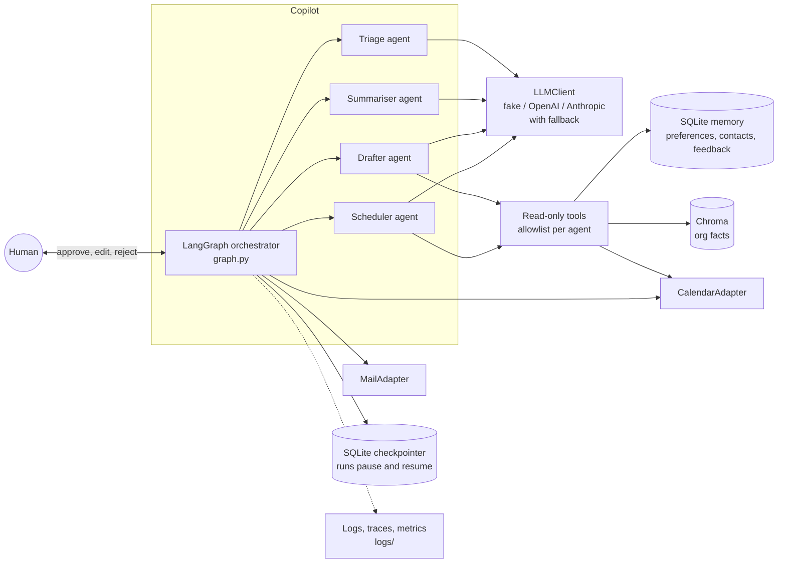
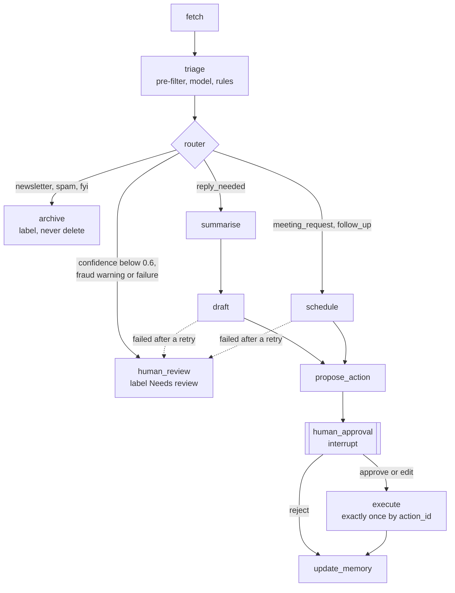

# betsson-email-copilot

A single-user productivity copilot on top of one existing mailbox and calendar, not a mail system.

It reads new mail, labels and routes it, summarises threads, drafts replies and schedules follow-ups. A human approves every outgoing action, the copilot learns from their edits, and every run is logged, traced and measured. It is built in Python with LangGraph and Pydantic. Nothing is ever really sent: mail and calendar go through mock adapters backed by JSON files.

**Contents:** [Quick start](#1-quick-start) · [Architecture](#2-architecture-and-execution-flow) · [Agents and routing](#3-agent-design-and-the-routing-decision) · [Structured I/O](#4-structured-io-and-validation) · [Memory](#5-memory) · [Human in the loop](#6-human-in-the-loop-and-action-policy) · [Observability](#7-observability) · [Classifier evaluation](#8-classifier-evaluation) · [Security](#9-security-notes) · [Limitations and next steps](#10-limitations-and-future-improvements)

Design decisions, each with the alternative and the trade-off, are in [`DECISIONS.md`](DECISIONS.md). The original plan is in [`PLAN.md`](PLAN.md).

## 1. Quick start

Requires Python 3.11 or newer. No API keys are needed: `LLM_PROVIDER=fake` is the default and gives the same output on every run.

```bash
python -m venv .venv
.venv/bin/pip install -r requirements.txt      # Windows: .venv\Scripts\pip install -r requirements.txt
.venv/bin/pytest                               # 139 tests
.venv/bin/python scripts/process_inbox.py      # triage table and metrics; stops before any approval
.venv/bin/python scripts/copilot.py run        # interactive: approve, edit, reject or skip each action
.venv/bin/python scripts/copilot.py memory     # preferences (seeded or learned) and feedback
.venv/bin/python scripts/copilot.py outbox     # what was "sent" and scheduled (mock files in runtime/)
.venv/bin/python scripts/show_trace.py e07     # the latest run for an email, as a waterfall
.venv/bin/python scripts/eval_classifier.py    # classifier evaluation on 20 labelled emails
```

The end-to-end demo, with scripted decisions, is [`notebooks/demo.ipynb`](notebooks/demo.ipynb). It follows the demo script: triage table, a reply edited and sent, the learned preference, a second email drafted in the new style, a meeting booked, newsletters and spam archived, the review queue, exactly-once execution, a simulated provider outage, and the metrics and traces.

The first run downloads Chroma's local embedding model (about 80 MB); set `KNOWLEDGE_BACKEND=keyword` to skip it. Delete `runtime/` to start the interactive CLI from scratch.

### Running with a real model

Copy `.env.example` to `.env`, add a key and choose the provider, in `.env` or for one run:

```bash
LLM_PROVIDER=openai    .venv/bin/python scripts/process_inbox.py   # needs OPENAI_API_KEY
LLM_PROVIDER=anthropic .venv/bin/python scripts/process_inbox.py   # needs ANTHROPIC_API_KEY
```

On Windows PowerShell: `$env:LLM_PROVIDER="openai"; .venv\Scripts\python scripts\process_inbox.py`. A small model does triage and a stronger one drafts (defaults: `gpt-5.4-mini` and `gpt-5.4`, `claude-haiku-5-5` and `claude-sonnet-5-5`, all set in `.env`). With both keys set, the other provider is the fallback.

## 2. Architecture and execution flow



One email is one run of the graph. Routing is plain code on the triage result; the agents are where the model chooses what to do.



Which emails are processed: the inbox has 15 emails in 10 threads, and only the latest message of each thread is processed, when it is unread and not sent by the user. Earlier messages are context for the agents.

| Path | What it is |
|---|---|
| `src/assistant/graph.py` | The orchestrator: nodes, router, `process_email()` |
| `src/assistant/agents/` | Triage (pre-filter and rules), summariser, drafter, scheduler, learner, the bounded tool loop |
| `src/assistant/tools.py` | Read-only tools with Pydantic-validated arguments and per-agent allowlists |
| `src/assistant/llm/` | `LLMClient` interface, `FakeLLM`, OpenAI and Anthropic providers, tracing wrapper, fallback, price table |
| `src/assistant/adapters/` | `MailAdapter` and `CalendarAdapter` interfaces plus JSON-file mocks |
| `src/assistant/memory/` | SQLite long-term memory and the Chroma knowledge base |
| `src/assistant/approval.py`, `policy.py` | Approval view, edit validation, `action_id`, `requires_approval()` |
| `src/assistant/observability/` | structlog logging, OpenTelemetry tracing, metrics, trace waterfall |
| `src/assistant/evaluation.py` | Classifier evaluation |
| `src/assistant/schemas.py`, `config.py` | Every message as a Pydantic model; settings from `.env` |
| `data/` | Sample inbox, calendar, org facts, seed memory, labelled evaluation set |
| `notebooks/demo.ipynb`, `sample_logs/` | The demo, and the logs and traces from one run of it |

## 3. Agent design and the routing decision

**Deterministic routing, agentic workers.** The router is a conditional edge in code, not an LLM supervisor. Routing is the most important decision in the flow, so it should be predictable, testable and free. Anything uncertain goes to a human instead of to a cleverer router (D18).

| Agent | Model | How it gets its data | Output |
|---|---|---|---|
| Triage | small | Pre-fetched in code: the thread and the sender's contact record | `TriageResult` |
| Summariser | strong | Pre-fetched: the thread | `ThreadSummary` |
| Drafter | strong | Tool loop: `get_thread`, `search_knowledge`, `get_preferences`, `lookup_contact` | `DraftReply` |
| Scheduler | strong | Tool loop: `check_availability`, `get_preferences` | `ScheduleProposal` |
| Learner | small | The draft before and after a human edit | `LearnedPreferences` |

Triage and summary always need the same data, so code fetches it (cheaper and deterministic). Drafting and scheduling benefit from choosing what to look up, so they get a real tool loop with native tool calling (D15). The loop is ours, not the SDK's: at most 4 tool calls, an allowlist per agent, arguments validated before a tool runs, and after the limit the model must answer.

**Classifier and ranker.** Triage is a pipeline: a rule-based newsletter pre-filter (`List-Unsubscribe` header, no-reply senders, known newsletter senders) skips the model entirely; the model returns intent, priority, topic tags, confidence and a rationale; then `apply_priority_rules()` adjusts it. A VIP sender or deadline language raises priority by one level, newsletters and spam are low, a known contact is never spam, and an unknown sender asking to change payment details, or writing from a domain that imitates a known partner's (`nordwind-billing.example` vs `nordwind.example`), is capped at confidence 0.5 with a fraud label, which forces human review (D20, D23).

## 4. Structured I/O and validation

Every message between agents, tools and the human is a Pydantic v2 model with `extra="forbid"` and time-zone-aware datetimes (`schemas.py`). Providers are asked for the schema natively (OpenAI strict JSON schema, Anthropic `output_config.format`, strict tool definitions), and the answer is still validated with Pydantic, so every provider is treated the same.

1. Ask for the schema.
2. If the answer is invalid, or the provider fails after its own retries, ask once more with the error included.
3. If that fails too, the email goes to the human review queue. Nothing is guessed.
4. Every failure increments `validation_failures_total` and is logged with the trace id.

Edits from the human are validated the same way: an edited draft must still be a valid `DraftReply` before anything is sent.

## 5. Memory

| Kind | Where | What |
|---|---|---|
| Short-term | LangGraph state + SQLite checkpointer (`runtime/checkpoints.db`) | The run so far. A run waiting for approval survives a restart and resumes in a new process. One checkpointer thread per email. |
| Long-term | SQLite (`runtime/memory.db`) | Preferences (sign-off, reply length, working hours...), contacts (VIP flag), feedback on every decision |
| Knowledge | Chroma, local embedding model | Organisational facts from `data/org_facts.md`, each with an id the drafter cites |

**Learning loop.** When the human edits a draft, the learner compares before and after and may update a fixed set of keys (`sign_off`, `reply_length`, `greeting`, `tone`). The drafter's `get_preferences` tool returns those preferences plus the two most recent edits as examples. In the demo, shortening one reply and changing the sign-off makes the next similar reply short and signed "Best, Erland".

**Write policy (A8).** Long-term memory is written only from human decisions and the seed file, never from email content, so an email cannot plant a preference or make itself a trusted contact. A recipient becomes a contact only when the user approves a reply to them. Full email bodies are not stored; feedback stores our draft and the human's version.

## 6. Human in the loop and action policy

Before any outgoing action the graph stops at `interrupt()` and shows an approval view: the triage result and why, the thread summary, the proposed action, and the org facts the draft relied on. The human can approve, edit or reject, or skip and decide later.

| Action | Risk | Policy |
|---|---|---|
| Label, archive | Low, reversible | Automatic, logged. Never delete. |
| Send email | High, external | Always needs approval |
| Create calendar event | Medium, visible to others | Needs approval |
| Create task or reminder | Low, private | Needs approval (the brief says all outgoing actions) |

The policy is one function, `requires_approval()`, driven by `APPROVAL_MODE`. The default `all` matches the brief. `risk_based` shows how it would relax in production: private, reversible reminders could run on their own, while anything that leaves the company or touches other people's calendars still needs a human.

**Exactly once.** The execute node derives a deterministic `action_id` from the email and the final payload, and the adapters check for it before acting, so a retried or resumed run never sends twice (D27).

## 7. Observability

Every run writes to `logs/`. [`sample_logs/`](sample_logs/) is a copy from one run of the demo notebook.

| Signal | File | What |
|---|---|---|
| Logs | `app.jsonl` | JSON lines with `run_id`, `email_id`, `trace_id`, node, tool, latency, tokens, cost, outcome |
| Errors | `errors.jsonl` | Only the errors, with the same ids |
| Traces | `traces.jsonl` | OpenTelemetry: one trace per email run, a span per node, LLM call (GenAI conventions) and tool call. Also sent to Jaeger when `OTEL_EXPORTER_OTLP_ENDPOINT` is set. |
| Metrics | `metrics.json` | Emails by intent, tool calls, validation failures, errors, decisions, fallbacks, tokens, cost, node and LLM latency |

A run of the meeting request, from `scripts/show_trace.py e07` (fake model, so the times are tiny):

```
email_run                                |##############################|    23.7 ms
  node triage                            |  ##                          |     1.5 ms
    chat fake-triage                     |   #                          |     0.8 ms  233 in / 7 out
  node schedule                          |     ###########              |     9.0 ms
    chat fake-draft                      |      #                       |     0.2 ms
    execute_tool get_preferences         |      #                       |     0.2 ms
    chat fake-draft                      |       #                      |     0.1 ms
    execute_tool check_availability      |       #######                |     5.5 ms
    chat fake-draft                      |               ##             |     1.4 ms  287 in / 14 out
  node propose_action                    |                  #           |     0.1 ms
  node human_approval                    |                   #          |     0.1 ms  waiting for human
  node human_approval                    |                       #      |     0.1 ms
  node execute                           |                        #     |     1.1 ms
  node update_memory                     |                           ## |     1.5 ms
```

`sample_logs/trace_e03_fallback.txt` shows the simulated outage: each failed call to the broken provider is followed by a good one on the fallback.

**Reliability.** The SDKs retry rate limits, server errors and timeouts with backoff (`LLM_MAX_RETRIES`, `LLM_TIMEOUT_SECONDS`). After that, a call moves to the other provider's model for the same task (D37). Runaway loops are bounded twice: 4 tool calls per agent and LangGraph's step limit of 25 per run. Prompts and email bodies are not written to traces or logs (an error message can quote part of a bad model answer).

## 8. Classifier evaluation

`data/eval_emails.json` holds 20 labelled emails that are not in the demo inbox, with every intent covered and a one-line reason for each label. The hard cases are deliberate: a sales pitch that asks for a call (spam, not a meeting), slides shared with "let me know if you have questions" (fyi), marketing without an unsubscribe header, and phishing from a lookalike brand domain. `scripts/eval_classifier.py` runs the whole triage step (pre-filter, model and rules) and reports accuracy, per-intent precision and recall, a confusion matrix, accuracy by confidence bucket, latency and cost per email, for any number of models in one table.

| Model | Intent acc. | Macro F1 | Priority acc. | To review | Wrong, not reviewed | Failures | Avg ms | p95 ms | Cost/email |
|---|---|---|---|---|---|---|---|---|---|
| fake (keyword baseline) | 55% | 0.58 | 75% | 45% | 3 | 0 | 0 | 1 | $0.00000 |

The fake model is a keyword baseline, there to keep the demo deterministic, and it is not a real classifier. Two things in its numbers still matter. Confidence is informative: in the full report, accuracy is 33% below 0.6, 67% between 0.6 and 0.8, and 100% above. The review threshold also works: 6 of its 9 mistakes went to a human, and "Wrong, not reviewed" counts the 3 it would have acted on. That column is the one to watch when comparing models.

To compare real models (keys from `.env`, fallback switched off so each number belongs to the model named):

```bash
.venv/bin/python scripts/eval_classifier.py fake openai:gpt-5.4-mini anthropic:claude-haiku-5-5 --markdown sample_logs/eval_models.md
```

## 9. Security notes

- **Email is untrusted input.** Prompts put email text inside `<email>` tags and tell the model it is data, never instructions. A prompt injection can at most produce a bad proposal, and every outgoing action needs a human.
- **Least-privilege tools.** All agent tools are read-only. Each agent has its own allowlist, and arguments are validated before a tool runs (for example, availability searches are limited to 14 days). Only the execute node writes to mail and calendar, and only after approval.
- **Memory poisoning.** Long-term memory is written only from human decisions, and the learner can change only four fixed keys.
- **Fraud.** Payment-change language from an unknown sender, and lookalike domains of known contacts, force human review with a warning label.
- **Secrets and data.** Keys come from `.env`, which is git-ignored. OpenAI runs with `store=False`. Traces do not record prompts or email text. No delete action exists in the mail adapter.

## 10. Limitations and future improvements

**Limitations**
- The mailbox and calendar are mocks; there is no OAuth or real mail API.
- The fake model is keyword-based. It shows the flow, not the quality; real quality comes from the providers.
- The evaluation set has 20 emails, labelled by us. It is enough to compare models and catch regressions, but not to make claims about accuracy in general.
- Single user, one process, no queue. Each email is processed in turn.
- No circuit breaker: if a provider is down, each call tries it once before falling back.
- The knowledge base is rebuilt from the markdown file at start-up, which is fine for ten facts but not for thousands.

**What I would build next**
- Real Gmail or Microsoft Graph adapters with OAuth, behind the same interfaces.
- Deploy on AWS: Bedrock as a third `LLMClient`, Bedrock AgentCore or containers on EKS, and queue-based processing per mailbox.
- Hosted tracing and evals (Langfuse or LangSmith), and the classifier evaluation in CI as a release gate.
- Prompt-injection and PII guardrails, with redaction before anything is stored.
- Multi-user and multi-tenant memory with access control.
- Better ranking, with weights learned from the user's approvals, edits and rejections.
- Cost controls: model routing by task, prompt caching, and token budgets per run.
